# Task Manager for Mac

**A Windows 11-style Task Manager for macOS.** Processes, Performance, App history, Startup apps, Users, Details and
Services, laid out and behaving like the Task Manager in Windows 11, built natively for macOS with live graphs,
per-process GPU, network and power use, and optional advanced pages for drivers, connections, disk space, power
sensors and Apple silicon internals.

This repository is the [Homebrew](https://brew.sh) tap that distributes it. It holds the cask, the release
downloads and the documentation; the app's source code is not published.

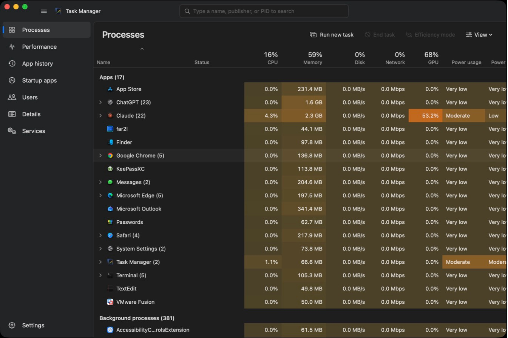

| | |
|---|---|
| Latest version | **1.6** (build 56), 23 November 2026 ([what's new](#whats-new-in-16)) |
| Requires | macOS 14 Sonoma or later |
| Runs on | Apple silicon and Intel (universal app) |
| Price | Free, also for commercial use ([license](#license)) |
| Signing | Ad-hoc signed, not notarized ([first launch](#first-launch)) |
| Author | [alexd-gh](https://github.com/alexd-gh) |

[Install](#install) · [First launch](#first-launch) · [What's new](#whats-new-in-16) · [Features](#features) · [Screenshots](#screenshots) ·
[Permissions and privacy](#permissions-and-privacy) · [Known limits](#known-limits) · [License](#license) ·
[Technical overview](docs/technical-overview.md) · [Release history](CHANGELOG.md)

## Install

```bash
brew install --cask alexd-gh/tap/win-task-manager
```

If Homebrew refuses to load a cask from an untrusted tap (Homebrew 7 and later), trust this tap first:

```bash
brew trust alexd-gh/tap
```

Without Homebrew, download `TaskManager-<version>.zip` from [Releases](https://github.com/alexd-gh/homebrew-tap/releases),
unzip it and drag **Task Manager** to Applications.

| Task | Command |
|---|---|
| Update | `brew upgrade --cask win-task-manager` |
| Uninstall | `brew uninstall --cask win-task-manager` |
| Uninstall and delete settings, app history and process samples | `brew uninstall --zap --cask win-task-manager` |

## First launch

1. **Open Anyway.** The app is ad-hoc signed and not notarized by Apple, so macOS blocks the first launch. Open it
   once, then go to System Settings › Privacy & Security and click **Open Anyway** next to Task Manager. You do this
   once per version.
2. **License.** Task Manager shows its license and asks you to accept it before any window opens. **Accept**
   continues and is remembered; **Quit** (or Escape) closes the app. You're asked again only if the license terms
   change. The text is always available under Task Manager › About Task Manager › License….

## What's new in 1.6

A safety and reliability release.

**Safer End task.** Ending WindowServer, loginwindow or another critical system process now asks first, as Windows
does. End task, priority and Efficiency mode check that the process is still the one you picked, so a reused process
ID is left alone, and End process tree won't touch launchd.

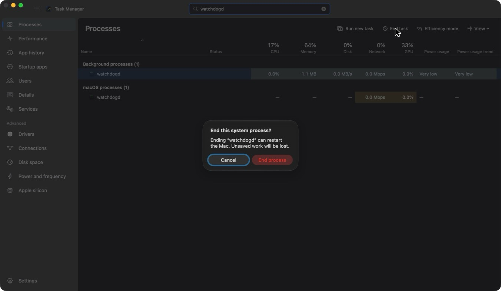

**Trustworthy publishers.** "Apple Inc." and the Apple driver vendor now come only from Apple's own signature; code
that was changed after signing shows "Invalid signature". Signatures are checked in the background, so large apps
no longer slow a refresh.

**Safer Restart as administrator.** Task Manager checks that its program file is still the code that's running before
starting the administrator copy, and the app is now signed with the hardened runtime. In the administrator copy, Run
new task opens things as you unless you tick the administrator box, and commands run as administrator write their
output to `~/Library/Logs/Task Manager`. Settings you change before restarting always carry over, and Disk space's
Move to Trash is off while elevated.

**Connections** looks up at most four host names at a time, and a new **Look up host names** switch turns the lookups
off.


Also: Disk space scans use far less memory (about 170 MB instead of 1.1 GB for ~/Library), helper commands can't hang
a page, network speeds stay right on fast links, and the battery log is read only while Performance is open.

1.5 added core kinds on the CPU page and a memory graph split by type; earlier releases added open handles per
process, Find open file or port, double-click-to-fill-the-screen and background Disk space scans. Every change is in
the [release history](CHANGELOG.md), with pictures in the [screenshot tour](docs/screenshots.md#new-in-12-to-16).

## Features

### Pages

| Page | What it shows | What you can do |
|---|---|---|
| **Processes** | Apps (with their helpers nested), background processes and macOS processes; CPU, memory, disk, network and GPU as a heat map with totals in the header; power usage and its trend (Very low … Very high) | End task, force quit, efficiency mode, switch to, create a process sample, open file location, search online, properties; choose columns by right-clicking the header |
| **Performance** | CPU (overall or per core, each core tagged efficiency or performance), memory (in use, or split by type), one tile per disk, each Wi-Fi and Ethernet adapter, GPU (3D and tiler), and battery on Macs that have one; 60 seconds of history each | Copy a summary, graph summary view, network details |
| **App history** | CPU time, network and energy per app over the last 30 days, recorded while Task Manager runs | Delete usage history |
| **Startup apps** | Launch agents and daemons with publisher, status, whether running now, when disabled, type and command | Enable or disable, properties, open file location |
| **Users** | Each signed-in user, including remote sessions, plus grouped system accounts | Process actions, sign out |
| **Details** | Every process, with open handles split into files, sockets and pipes (hover for the breakdown), and optional columns such as architecture, CPU time, peak memory, disk read/written, GPU, elevated, parent PID and start time | End task or process tree, set priority, efficiency mode, process sample, properties with Network and Files tabs |
| **Services** | launchd services: your agents (User) and system daemons (System), with PID, description and state | Start, stop, restart |
| **Settings** | Theme, start page, update speed, open at login, always on top, menu bar icon, hide when minimized, Control-Shift-Escape, graph style, advanced readings and pages | — |

### Advanced pages

Switched on in Settings, an **Advanced** section adds pages that Windows Task Manager doesn't have:

| Page | What it shows |
|---|---|
| **Drivers** | Loaded kernel extensions, installed kernel and driver extensions, and system extensions |
| **Connections** | Every open network connection by process, with remote host names, service names and traffic, plus a Firewall settings shortcut |
| **Disk space** | A scan of a volume as a treemap and folder list, with file categories and a history of earlier scans; a scan keeps running while you use other pages |
| **Power and frequency** | Power, voltage, current, temperature and fan sensors as a tree, with live values and their minimum and maximum |
| **Apple silicon** | The CPU cluster layout, GPU performance states with their frequencies and voltages, energy per chip block, and media engine activity |

### Also

- **Find open file or port** (Edit menu, ⇧⌘O): which processes hold a file, folder, volume or network port open.
- **Open handles** per process: Properties › Network shows live sockets with state and traffic, Properties › Files
  every open file, folder, device and pipe.
- **Double-click the title row** to fill the screen, leaving the menu bar and Dock visible, as maximizing does on
  Windows.
- **Menu bar icon** with live CPU use, a floating **graph summary** window and a compact **Fewer details** window.
- **Extended graphs**: an optional graph style with smooth glowing curves coloured by level and LED meters.
- **Show advanced readings**: CPU clock speed, Neural Engine (NPU) power, temperatures and "Not responding" status.
- **Restart as administrator** (File menu) to see CPU, memory and disk for other users' and root's processes.
  Ending a critical system process asks first.
- **Control-Shift-Escape** brings Task Manager forward and, if you switch it on, also opens it when it isn't running.
- **One copy only**, as on Windows: launching it again brings the running window forward.
- **Light and dark app icon**; on macOS 26 and later the Dock and Finder switch with dark mode.

### Keyboard shortcuts

| Shortcut | Action | Shortcut | Action |
|---|---|---|---|
| ⌘F | Search | ⌘N | Run new task |
| ⌘1 – ⌘8 | Switch page | ⌥⌘1 – ⌥⌘5 | Advanced pages (when on) |
| ⌘R | Refresh now | ⌘⌫ | End task |
| ⌘E | Efficiency mode | ⌘I | Properties (Details) |
| ⇧⌘C | Copy summary | ⌥⌘D | Fewer details |
| ⌥⌘G | Graph summary view | ⌥⌘T | Always on top |
| ⇧⌘O | Find open file or port | ⌃⇧⎋ | Show Task Manager |

## Screenshots

Every page, with a caption, is in the [screenshot tour](docs/screenshots.md). Personal details are covered with
grey bars.

<table>
  <tr>
    <td width="33%"><a href="docs/screenshots.md#cpu"></a><br><sub>Performance: CPU</sub></td>
    <td width="33%"><a href="docs/screenshots.md#memory"></a><br><sub>Performance: Memory</sub></td>
    <td width="33%"><a href="docs/screenshots.md#gpu">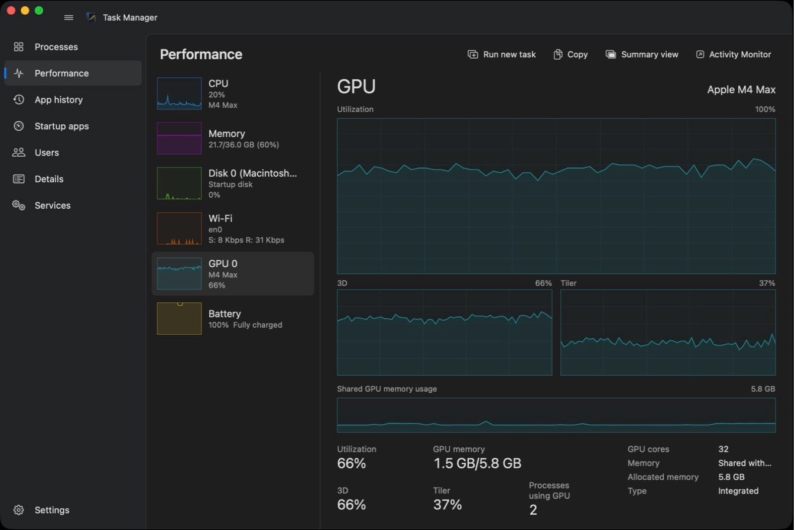</a><br><sub>Performance: GPU</sub></td>
  </tr>
  <tr>
    <td><a href="docs/screenshots.md#disk"></a><br><sub>Performance: Disk</sub></td>
    <td><a href="docs/screenshots.md#wi-fi"></a><br><sub>Performance: Wi-Fi</sub></td>
    <td><a href="docs/screenshots.md#battery"></a><br><sub>Performance: Battery</sub></td>
  </tr>
  <tr>
    <td><a href="docs/screenshots.md#app-history"></a><br><sub>App history</sub></td>
    <td><a href="docs/screenshots.md#startup-apps"></a><br><sub>Startup apps</sub></td>
    <td><a href="docs/screenshots.md#users"></a><br><sub>Users</sub></td>
  </tr>
  <tr>
    <td><a href="docs/screenshots.md#details">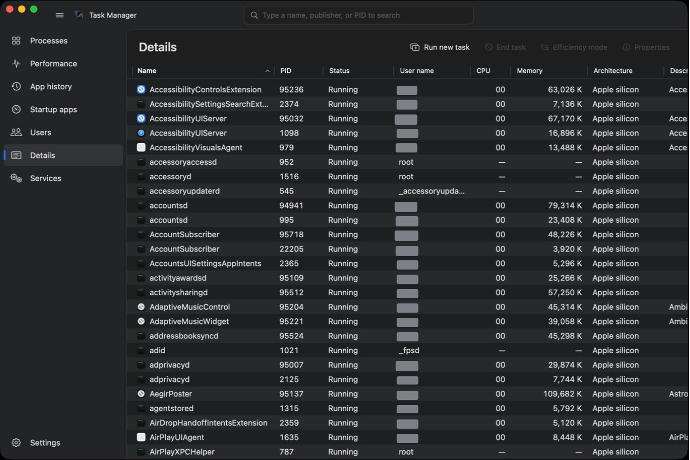</a><br><sub>Details</sub></td>
    <td><a href="docs/screenshots.md#services"></a><br><sub>Services</sub></td>
    <td><a href="docs/screenshots.md#settings"></a><br><sub>Settings</sub></td>
  </tr>
  <tr>
    <td><a href="docs/screenshots.md#about-and-license"></a><br><sub>About</sub></td>
    <td><a href="docs/screenshots.md#settings">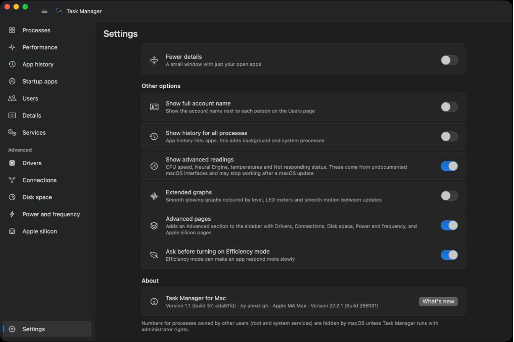</a><br><sub>Settings: other options</sub></td>
    <td><a href="docs/screenshots.md#about-and-license"></a><br><sub>License</sub></td>
  </tr>
  <tr>
    <td><a href="docs/screenshots.md#drivers"></a><br><sub>Advanced: Drivers</sub></td>
    <td><a href="docs/screenshots.md#connections"></a><br><sub>Advanced: Connections</sub></td>
    <td><a href="docs/screenshots.md#disk-space"></a><br><sub>Advanced: Disk space</sub></td>
  </tr>
  <tr>
    <td><a href="docs/screenshots.md#power-and-frequency"></a><br><sub>Advanced: Power and frequency</sub></td>
    <td><a href="docs/screenshots.md#apple-silicon"></a><br><sub>Advanced: Apple silicon</sub></td>
    <td><a href="docs/screenshots.md#settings"></a><br><sub>Settings</sub></td>
  </tr>
</table>

### With Extended graphs

The same app with Settings › Extended graphs on: glowing curves coloured by level, LED meters, status lights and
level bars on every page. All of them are in the [tour](docs/screenshots.md#extended-graphs).

<table>
  <tr>
    <td width="33%"><a href="docs/screenshots.md#extended-performance">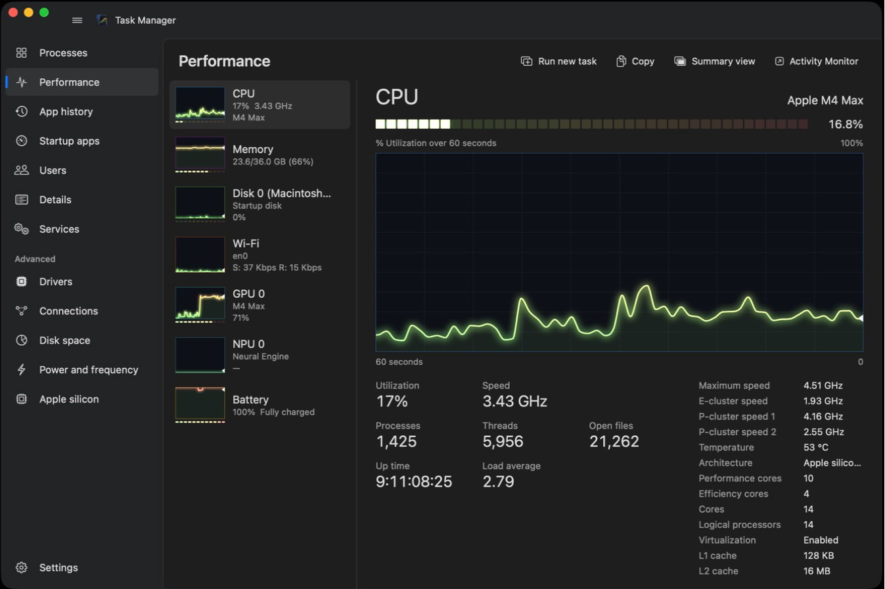</a><br><sub>CPU</sub></td>
    <td width="33%"><a href="docs/screenshots.md#extended-performance"></a><br><sub>Memory</sub></td>
    <td width="33%"><a href="docs/screenshots.md#extended-performance">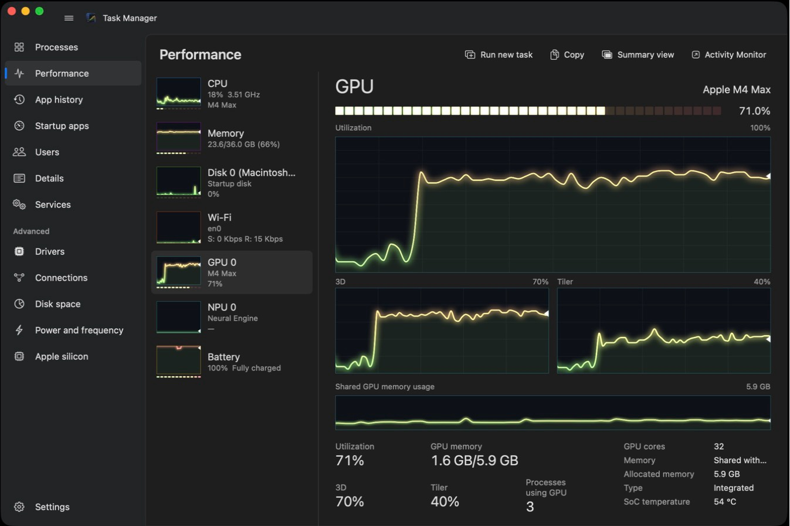</a><br><sub>GPU</sub></td>
  </tr>
  <tr>
    <td><a href="docs/screenshots.md#extended-performance"></a><br><sub>Disk</sub></td>
    <td><a href="docs/screenshots.md#extended-performance">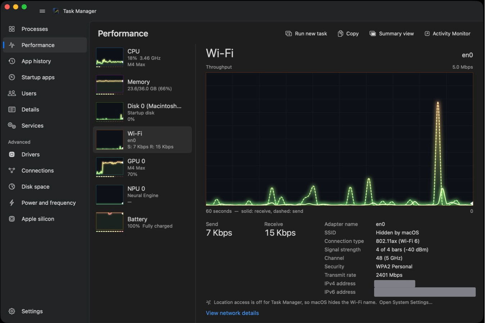</a><br><sub>Wi-Fi</sub></td>
    <td><a href="docs/screenshots.md#extended-performance">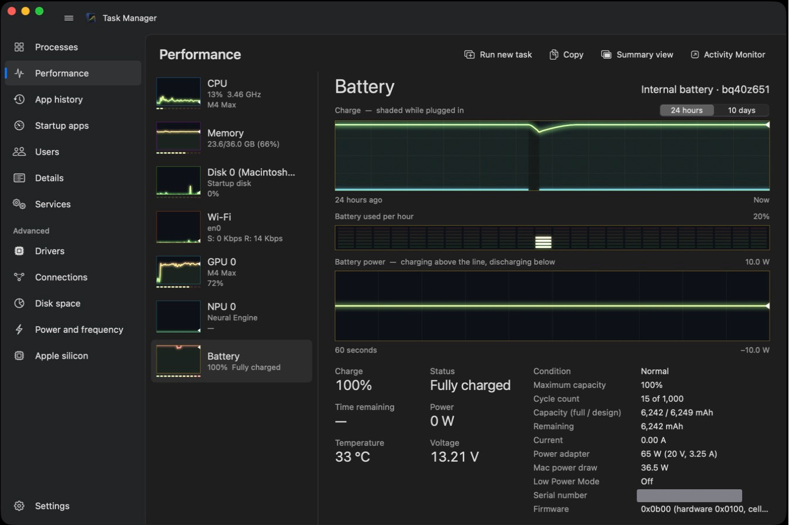</a><br><sub>Battery</sub></td>
  </tr>
  <tr>
    <td><a href="docs/screenshots.md#extended-processes"></a><br><sub>Processes</sub></td>
    <td><a href="docs/screenshots.md#extended-pages-without-graphs">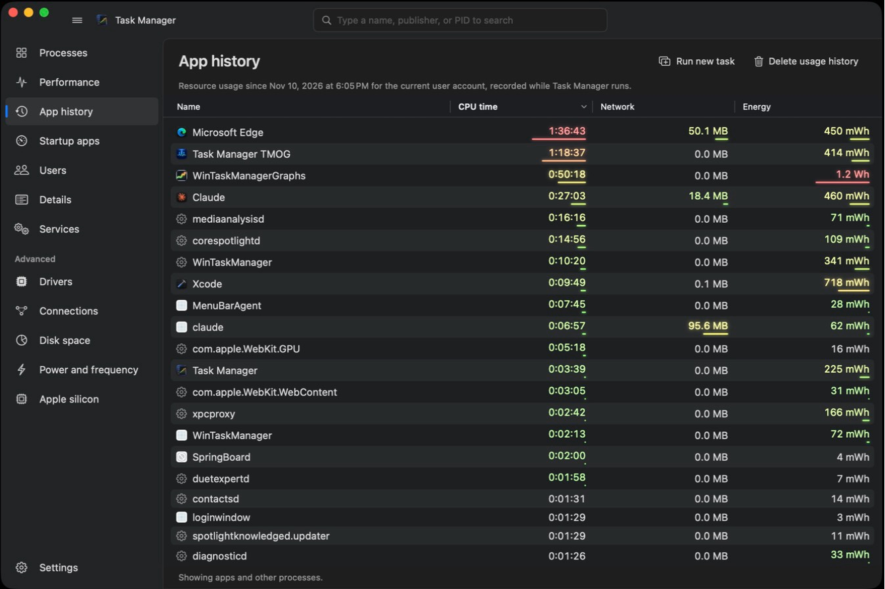</a><br><sub>App history</sub></td>
    <td><a href="docs/screenshots.md#extended-pages-without-graphs">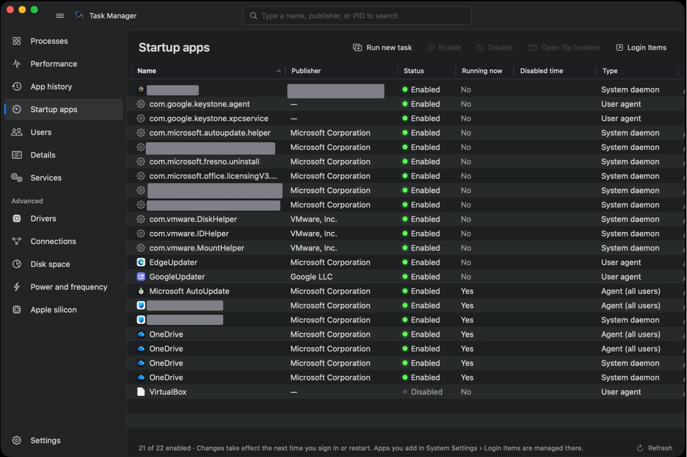</a><br><sub>Startup apps</sub></td>
  </tr>
  <tr>
    <td><a href="docs/screenshots.md#extended-advanced-pages"></a><br><sub>Power and frequency</sub></td>
    <td><a href="docs/screenshots.md#extended-advanced-pages"></a><br><sub>Apple silicon</sub></td>
    <td><a href="docs/screenshots.md#extended-graphs"></a><br><sub>Extended graphs settings</sub></td>
  </tr>
</table>

## Permissions and privacy

Task Manager has **no telemetry, no analytics, no accounts and no update checks**. It reads the state of your own Mac
and keeps what it records on your Mac.

| Access | When | Why |
|---|---|---|
| Administrator password or Touch ID | Only when you disable a system startup item, control a system service or restart as administrator | These change system-wide settings or need root |
| Location | Only if you allow it, for the Performance page's Wi-Fi tile | macOS shows the Wi-Fi network name only to apps with Location access. Your location itself is never read |
| Login items | Only if you switch on Open at login or Control-Shift-Escape when closed | Registers the app, or its small hotkey helper, as a login item; switch it off in Settings |
| Network | Only on the Advanced › Connections page | Looks up the names of remote hosts you're already connected to (reverse DNS); switch it off with **Look up host names**. **Search online** opens your web browser |

**Files it writes:**

| Location | Contents |
|---|---|
| `~/Library/Preferences/local.alexd-gh.wintaskmanager.plist` | Settings, license acceptance, startup-item disable dates, disk scan history |
| `~/Library/Application Support/Task Manager/` | App history (30 days; older days are deleted) |
| `~/Library/Logs/Task Manager/` | Process samples you create, and the output of commands run as administrator |

`brew uninstall --zap` deletes all three, and the settings file of versions before 1.2
(`local.alexander.wintaskmanager.plist`).

## Known limits

These are macOS rules, not bugs.

- **Other users' and root processes** show "—" for CPU, memory, disk and power until you restart as administrator.
  Efficiency mode works only on your own processes.
- **Per-process network** updates about every 5 seconds and can miss processes that live shorter than that.
- **Open handles** (Handles columns, Network and Files tabs, Find open file or port) are readable only for your own
  processes until you restart as administrator; Find says how many processes it couldn't search.
- **CPU speed** on Apple silicon needs Show advanced readings; otherwise "Load average" stands in for "Speed".
- **GPU** shows overall, 3D and tiler use. macOS has no Copy or Video engine breakdown, GPU temperature or driver version.
- **Startup changes** take effect at the next sign-in or restart.
- **Advanced readings and the Apple silicon and Power pages** use undocumented macOS interfaces, so a macOS update
  can change or break individual readings. Some energy readings need administrator rights on recent macOS.

Where each number comes from is in the [technical overview](docs/technical-overview.md).

## License

Task Manager for Mac is **freeware**. The full text is in [LICENSE](LICENSE).

- **You may** use it free of charge on any number of Macs, for any purpose, **including commercial use**, and share
  unmodified copies free of charge with the license included.
- **You may not** sell, rent or sublicense it, modify or reverse engineer it (except where the law allows), remove
  its copyright notice, or present it as your own.
- **It's provided as is.** There is no warranty of any kind, express or implied. To the maximum extent the law
  allows, the author is not liable for any direct, indirect, incidental, special or consequential damage, including
  loss of data or business interruption. Task Manager can end processes, change startup items and services and run
  commands as administrator: you're responsible for what you do with it.
- **The source code is not licensed** and is not part of this repository.

The app is written in Swift with Apple's frameworks only and contains **no third-party code or libraries**, so no
other licenses apply to it. Installing through this tap uses Homebrew, a separate project under its
[own license](https://github.com/Homebrew/brew/blob/master/LICENSE.txt).

Windows is a trademark of Microsoft Corporation; macOS and Mac are trademarks of Apple Inc. Task Manager for Mac is
not affiliated with, endorsed or sponsored by Microsoft or Apple.

## Support

Found a problem or have an idea? [Open an issue](https://github.com/alexd-gh/homebrew-tap/issues) with your macOS
version, your Mac model and the Task Manager version shown in About.
