# Screenshots

A tour of every page in Task Manager for Mac 1.1, taken on a MacBook Pro with an M4 Max in dark mode.
Personal details (account names, IP addresses, the battery serial number and some installed security software)
are covered with grey bars; everything else is as the app shows it.

[Processes](#processes) · [Performance](#performance) · [App history](#app-history) · [Startup apps](#startup-apps) ·
[Users](#users) · [Details](#details) · [Services](#services) · [Settings](#settings) · [Extended graphs](#extended-graphs) ·
[Advanced pages](#advanced-pages) · [About and license](#about-and-license)

Back to the [README](../README.md) · [Technical overview](technical-overview.md)

## Processes

Apps with their helpers nested, then background and macOS processes. CPU, memory, disk, network and GPU form a heat
map: the busier a cell, the darker its colour, with totals in the header. Power usage and its trend use Windows'
words, from Very low to Very high.

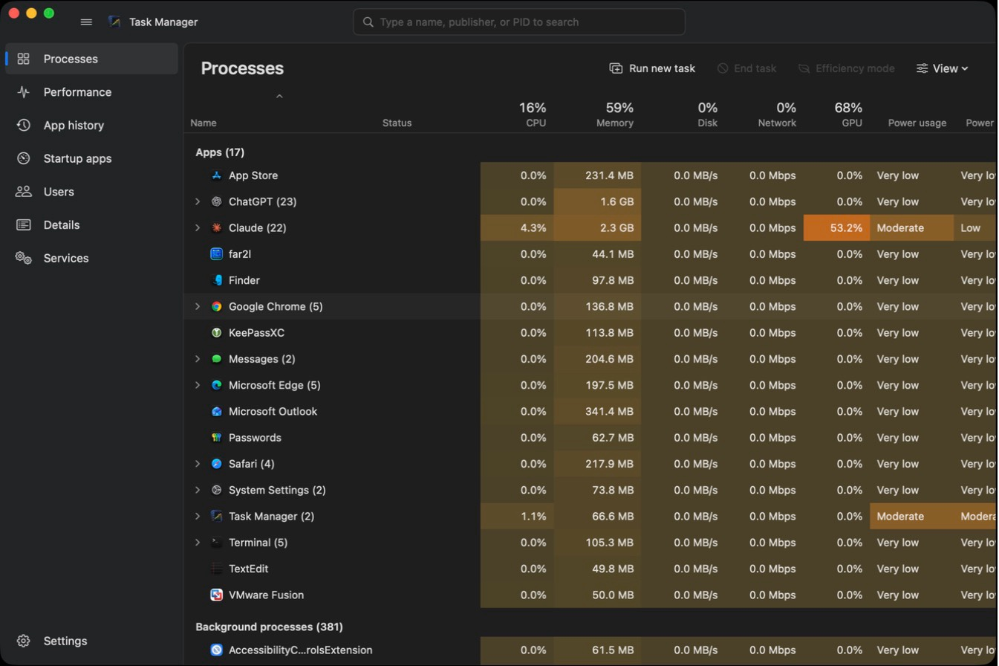

## Performance

One tile per resource on the left, with 60 seconds of history; the selected one fills the right side.

### CPU

Overall use (right-click the graph for one graph per core), processes, threads, open files, uptime, load average and
the chip's core layout.

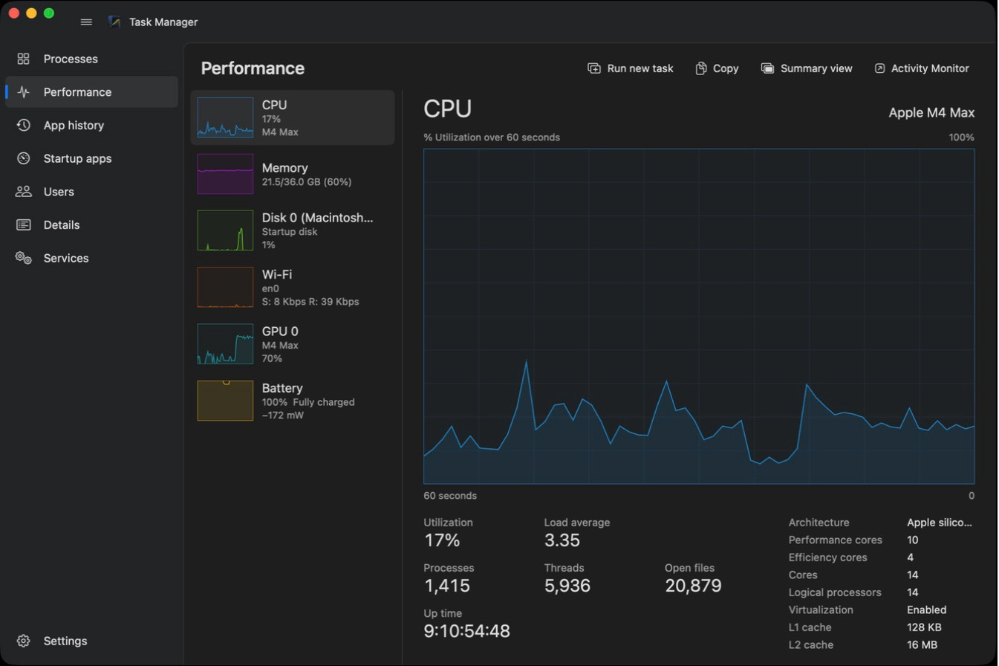

### Memory

Memory in use, the composition bar (app, wired, compressed, cached, free), swap, memory pressure, type and maker.

### Disk

One tile per physical drive: active time, transfer rate (solid read, dashed write), response time, capacity,
volumes and connection.

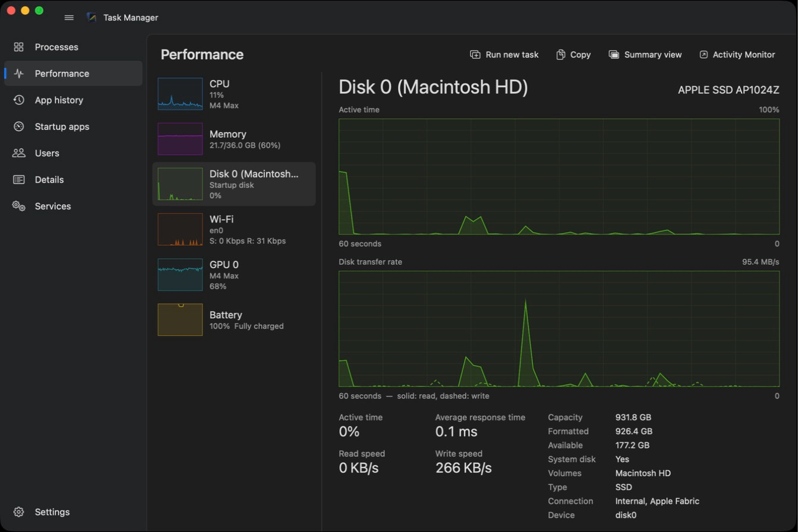

### Wi-Fi

Throughput, connection type, signal, channel, security, transmit rate and addresses. The network name needs Location
access because macOS hides it from apps otherwise.

### GPU

Utilization, the 3D (renderer) and tiler engines, and shared GPU memory.

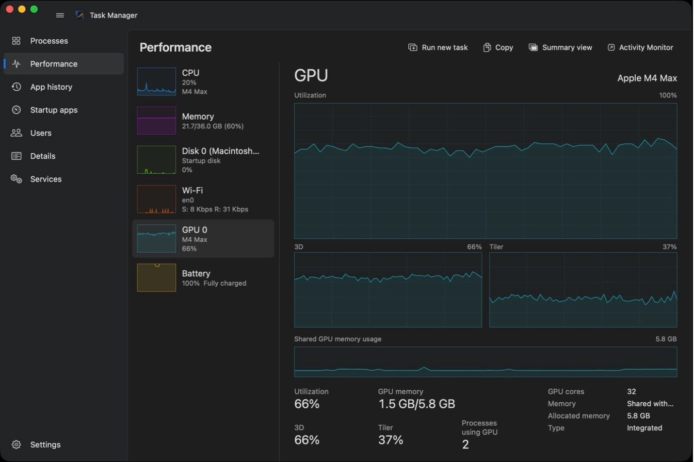

### Battery

On Macs with a battery: the charge over 24 hours or 10 days (shaded while plugged in), battery used per hour,
charging and discharging power, health, cycle count, capacity and the power adapter.

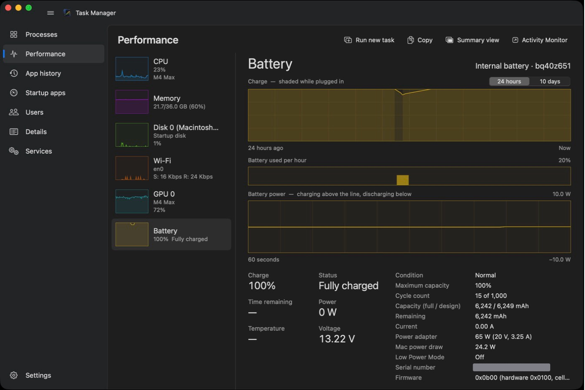

## App history

CPU time, network and energy per app over the last 30 days, recorded while Task Manager runs.

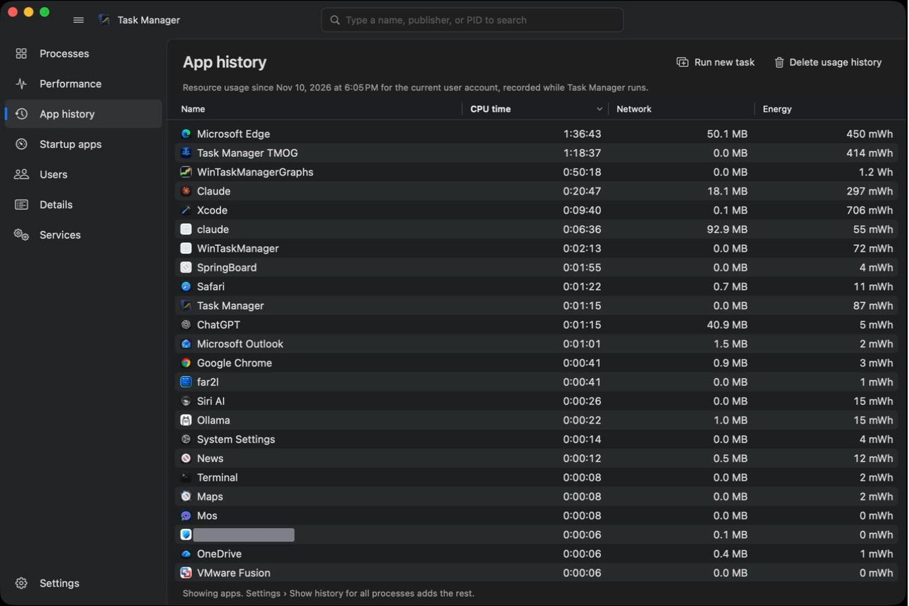

## Startup apps

Launch agents and daemons with their publisher, status, whether they're running now and when they were disabled.
Enable and Disable take effect at the next sign-in or restart.

## Users

Each signed-in user with their combined use, plus all system accounts grouped together. Expand a user to see their
processes.

## Details

Every process, Windows-style: PID, status, user name, CPU, memory, architecture and more columns from the header's
right-click menu. "—" means macOS only shares that number with administrators.

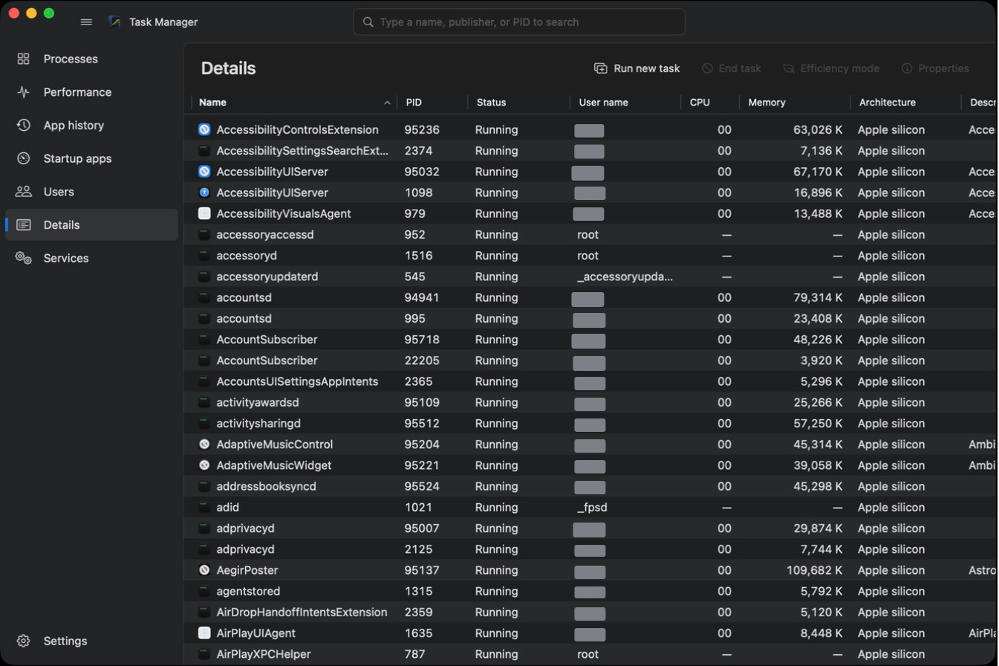

## Services

launchd services: your own agents (User) and system daemons (System), with PID, description and state. Start, Stop
and Restart; system services ask for your password or Touch ID.

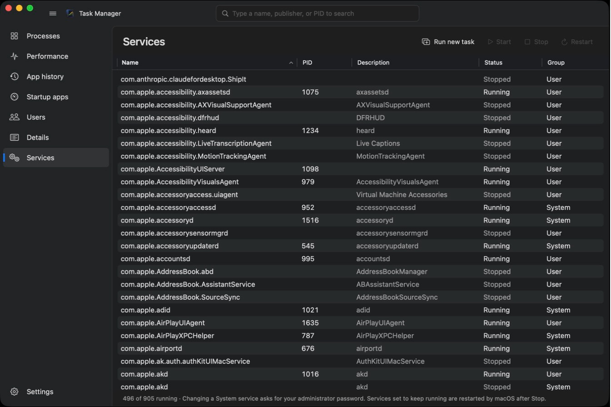

## Settings

Theme, start page, update speed, open at login, administrator mode and window behaviour…

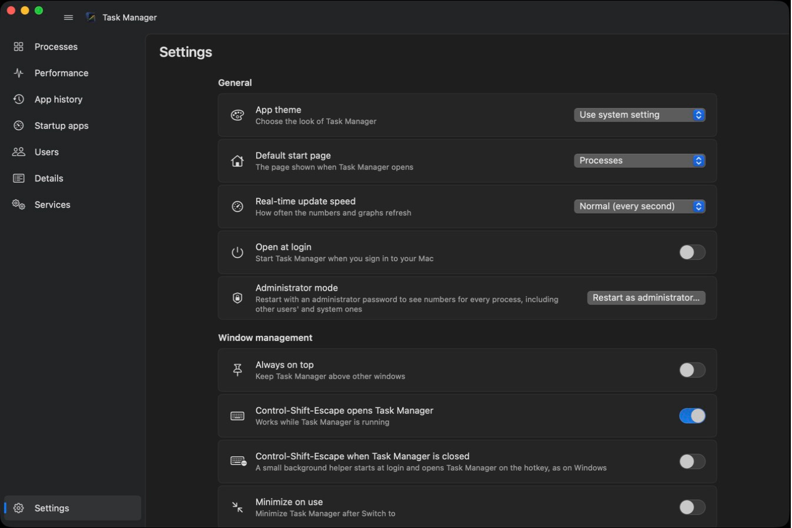

…and the other options: account names, history for all processes, advanced readings, Extended graphs and the
Advanced pages, with the version line at the bottom.

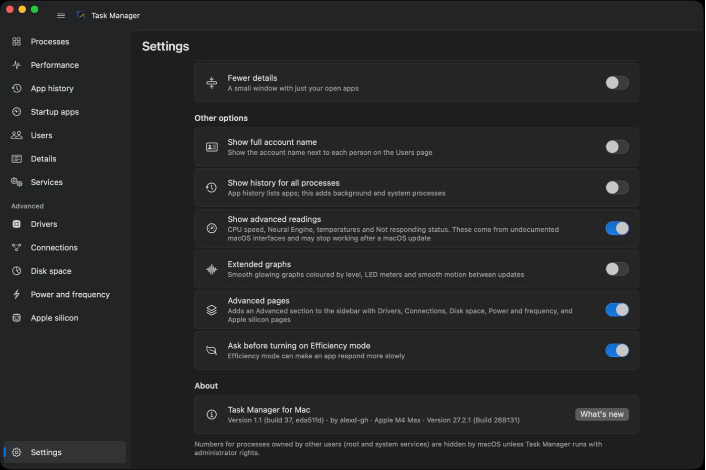

## Extended graphs

An optional graph style (Settings › Extended graphs): smooth glowing curves coloured by level, LED meters and a
"now" marker. With Show advanced readings also on, the CPU page adds the clock speed per cluster and temperature,
and an NPU tile appears.

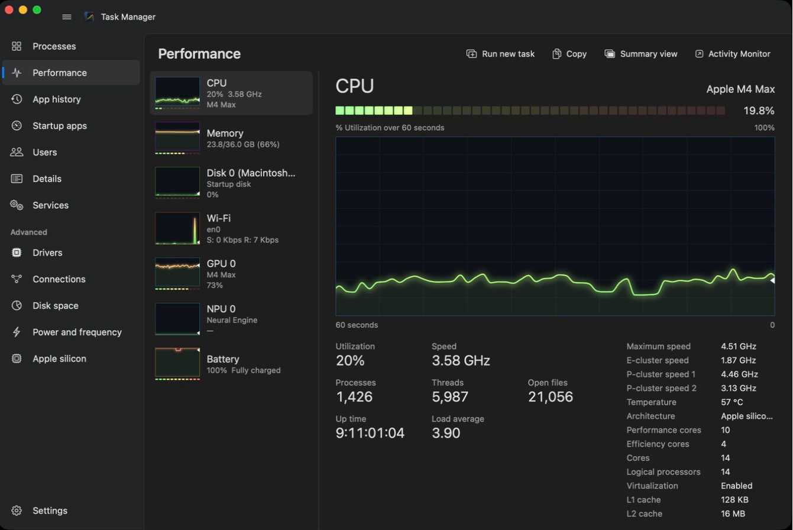

The Processes page gets LED meters in the header and level bars in each cell.

## Advanced pages

Switched on in Settings › Advanced pages, a new sidebar section adds pages Windows Task Manager doesn't have.

### Drivers

Installed and loaded kernel extensions, driver extensions and system extensions, with state, version, wired memory
and vendor.

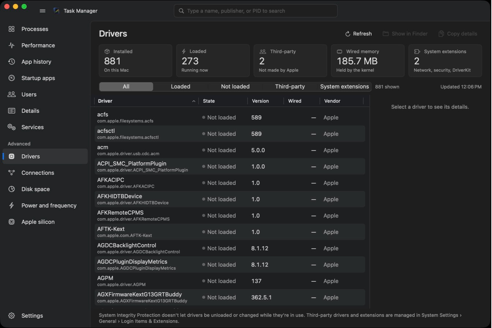

### Connections

Every open connection by app, with state, local and remote endpoints and traffic, filtered by connected, listening,
open to the network, UDP or this Mac.

### Disk space

Scan your home folder, a volume or any folder (here `/var`) and see it as a treemap, with file types, the largest
folders and the largest files. Nothing is changed unless you choose Move to Trash.

### Power and frequency

System power, the power adapter, CPU cluster clocks and activity, die temperatures, GPU and more, each with its
minimum and maximum since the last reset. Copy or save as CSV.

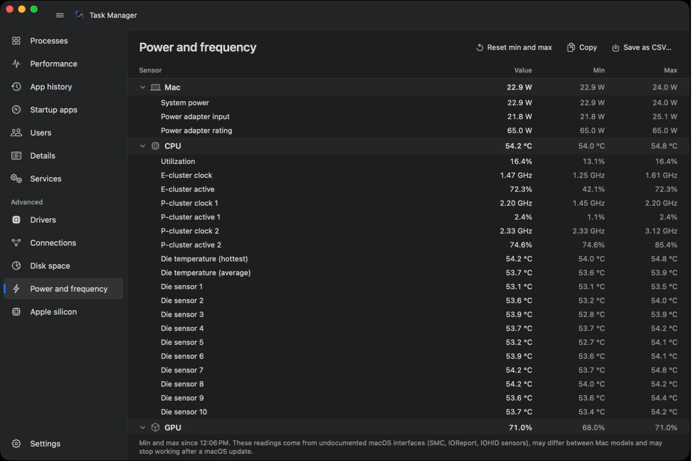

### Apple silicon

The chip's layout: each CPU cluster with its cores, clock and activity, the GPU's clock and power, the media engine
and power per block.

## About and license

Task Manager › About Task Manager shows the version, build and the changes in this build.

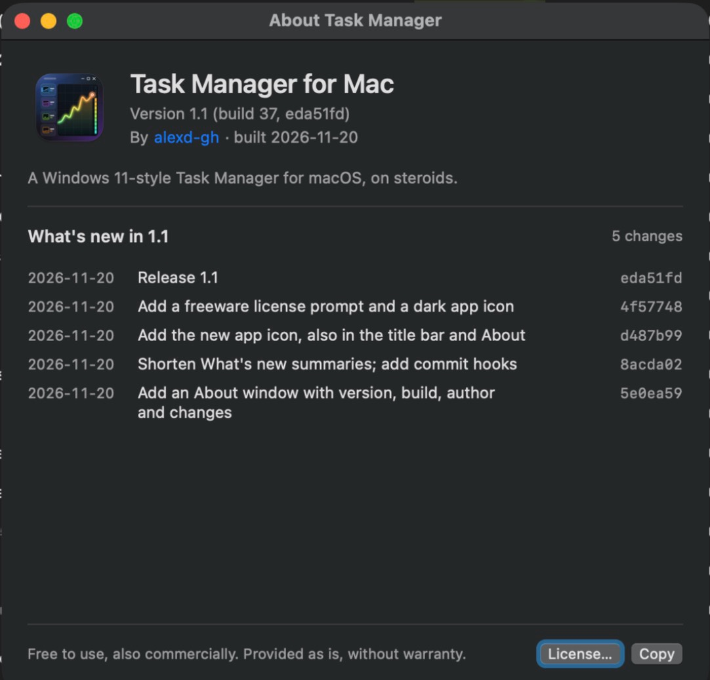

License… shows the full license and when you accepted it. The first launch asks you to accept the same text.

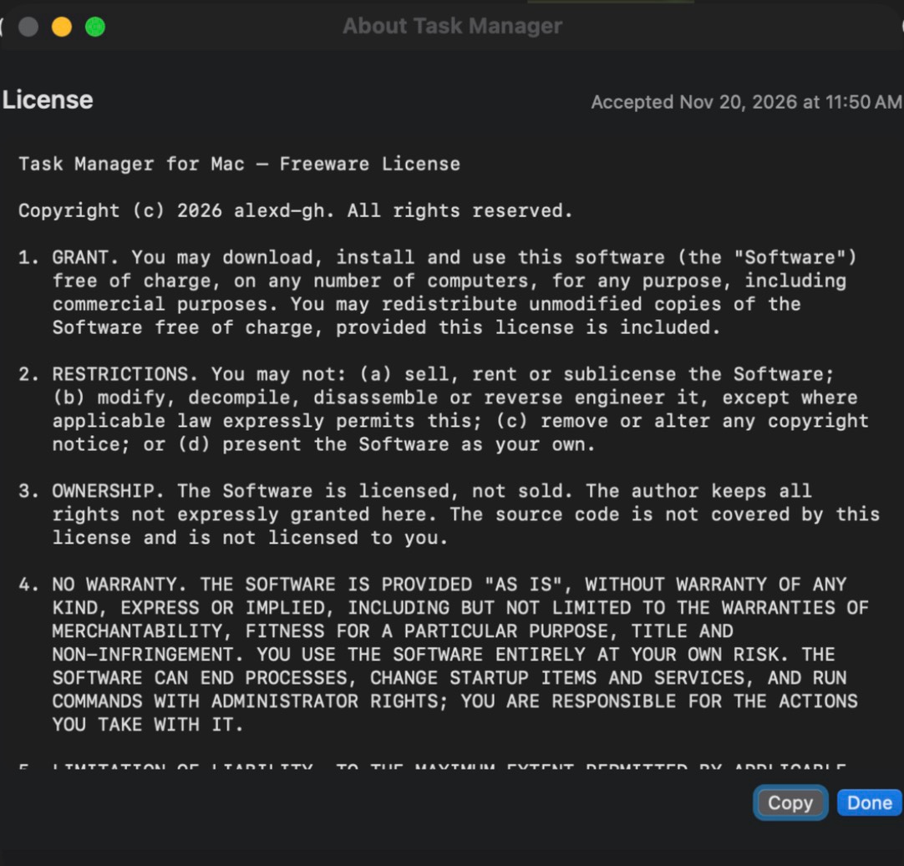
